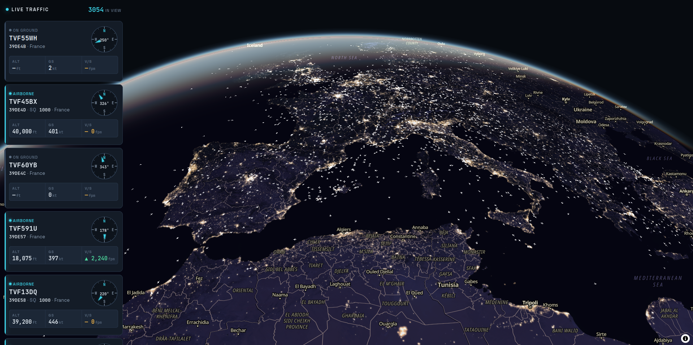

# Airspace Visualization

Live air traffic rendered on an interactive 3D globe. Aircraft stream in from the backend's
air traffic sources and are drawn in real
time as 3D models with raw WebGL2, with a side panel of live flight cards for everything
currently in view.

**[Live demo →](https://airspace.juanesroig.com)**



## Features

- **3D globe** built on MapLibre GL with a globe projection and a design-system-tinted atmosphere.
- **One instanced draw call for every aircraft.** A MapLibre custom layer shares the map's
  WebGL2 context and draws a single airplane mesh once per aircraft with
  `drawArraysInstanced`. No Three.js.
- **Dead reckoning on the GPU.** Between backend updates, the vertex shader moves each
  aircraft along its great circle from its heading and speed, so motion stays fluid
  instead of jumping on each update.
- **Horizon culling.** Aircraft on the far side of the globe are dropped in the vertex
  shader using the same horizon plane MapLibre clips the globe with.
- **GPU picking.** Hover and click redraw the aircraft into an offscreen framebuffer, each
  in a color that encodes its id, and read back the pixel under the cursor.
- **Live flight cards** for aircraft in the current viewport — callsign, altitude, ground
  speed, vertical rate, squawk, and an SVG compass — lazy-loaded as you scroll.
- **Bidirectional selection.** Hovering or selecting a card highlights the aircraft on the
  map and vice versa; selecting one flies the camera to it.

## Tech stack

React 19 · TypeScript · Vite · MapLibre GL · WebGL2

## Getting started

```bash
npm install
npm run dev
```

The dev server runs on Vite's default port. **The frontend needs a backend to show any
data** — see below.

### Scripts

| Command | Description |
| --- | --- |
| `npm run dev` | Start the Vite dev server. |
| `npm run build` | Type-check (`tsc -b`) then build for production. |
| `npm run preview` | Serve the production build locally. |
| `npm run lint` | Run ESLint over the repo. |

## Backend dependency

This frontend is a client only — it does **not** talk to any air traffic provider directly.
It expects a separate backend that aggregates several sources and pushes them over
**Server-Sent Events**, with named `success` / `error` events. The `success` event carries a
bare array of objects matching the `AircraftState` type in [`src/api.ts`](src/api.ts) —
keyed by `hex`, with `alt` in meters, `speed` in km/h, `v_speed` in m/s and `dir` in
degrees. Most fields are optional: aircraft without a position are skipped, and a missing
`speed` — 41% of airborne records in a live sample — is estimated from altitude so the
aircraft still moves, shown on the card with a `~` to mark it as a guess.

The backend base URL is configured with an environment variable (below). With no backend
reachable, the app shows its "Couldn't connect to live traffic" state.

## Environment variables

Copy `.env.example` to `.env` and fill in the values. Vite only exposes variables prefixed
with `VITE_`.

| Variable | Required | Description |
| --- | --- | --- |
| `VITE_API_URL` | Production | Base URL of the backend (no trailing slash), e.g. `https://your-backend.example.com`. Defaults to `http://localhost:5000` when unset, so local dev works out of the box. |

> **Deploying:** a deployed frontend is served over HTTPS, so `VITE_API_URL` must point at an
> **HTTPS** backend — browsers block plain-`http` (and thus `localhost`) requests from an
> HTTPS page. Set `VITE_API_URL` at build time on your host.

The basemap uses a hardcoded [MapTiler](https://www.maptiler.com/) style URL and key in
[`src/main.tsx`](src/main.tsx). If you deploy this, restrict that key to your domain in the
MapTiler dashboard so it can't be reused elsewhere.

## Architecture

Data flows: **backend SSE → `App.tsx` → `WebGLCustomLayer`**.

- **`index.html`** stacks two DOM layers: `#map` (the MapLibre globe) under `#root` (the React
  UI). `main.tsx` creates the `Map` instance and passes it into `<App map={map} />` — React
  drives the map, it doesn't own it.
- **[`src/webgl.ts`](src/webgl.ts) — `WebGLCustomLayer`** is the rendering engine: a single
  MapLibre custom layer that uploads per-aircraft data to instance buffers, dead-reckons and
  culls in the vertex shader, and answers `pick(point)` with a GPU color-picking pass.
- **[`src/aircraft.ts`](src/aircraft.ts)** holds the airplane mesh vertices, generated from
  `public/airplane.glb`.
- **[`src/App.tsx`](src/App.tsx)** owns UI state and wires MapLibre events to the layer.
- **[`src/api.ts`](src/api.ts)** types the states wire format and fills the gaps in it (`aircraft_speed`).
- **[`src/utils.ts`](src/utils.ts)** holds small helpers (angle conversion, `debounce`) and the
  loading-state types.

See [`CLAUDE.md`](CLAUDE.md) for a deeper tour.
